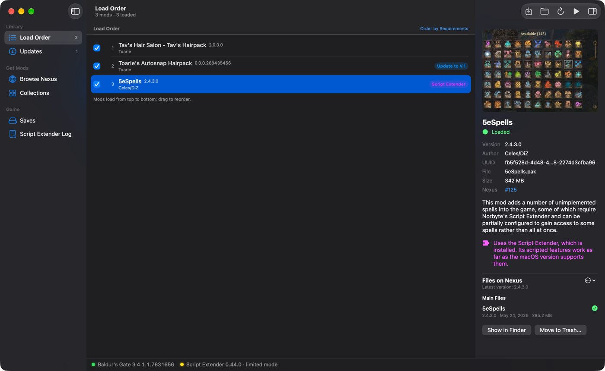
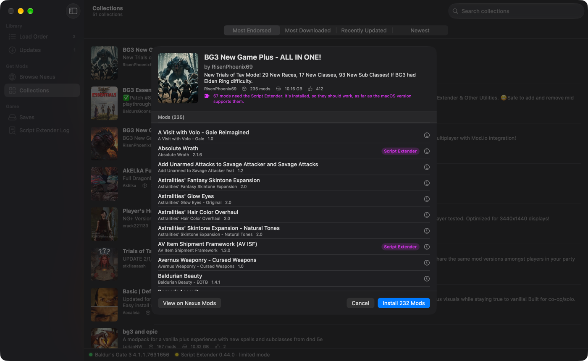
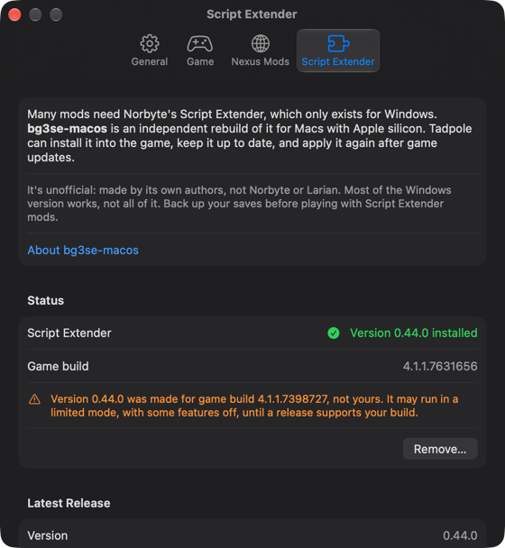
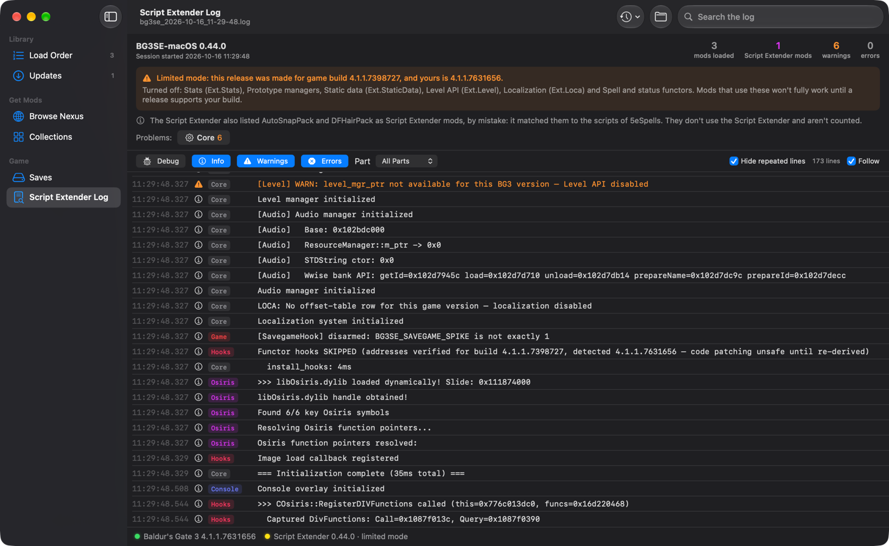
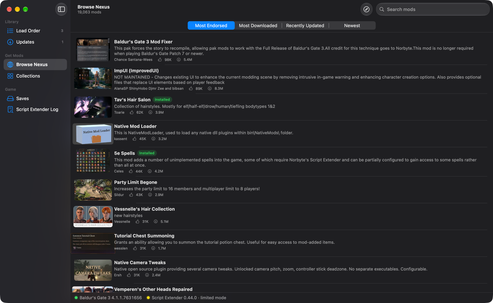
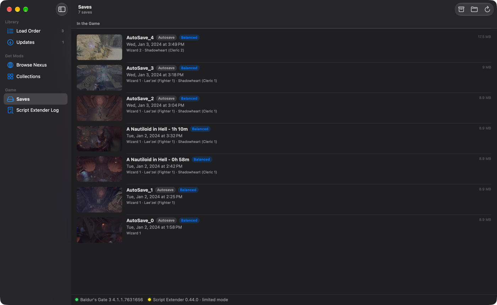

# Tadpole

*A mod manager for Baldur's Gate 3 on macOS.*

Install, order and update your Baldur's Gate 3 mods on a Mac: browse Nexus
Mods and install mods and collections in the app, set the load order, keep
mods up to date, run Script Extender mods, and back up your saves.

**[Download Tadpole for Mac](https://github.com/matguitarist/tadpole/releases/latest/download/Tadpole.dmg)**
(macOS 14 Sonoma or later)

## Install

1. Open the disk image and drag **Tadpole** onto **Applications**.
2. The first time, macOS says it can't check Tadpole, because it isn't signed
   with a paid Apple Developer ID. Open **System Settings → Privacy &
   Security**, scroll down, and click **Open Anyway**. This is needed only
   once: Tadpole updates itself after that.

## Getting started

1. Run Baldur's Gate 3 once and reach the main menu: the game creates the
   folders Tadpole works with.
2. To download mods in the app, add your personal Nexus Mods API key in
   **Settings → Nexus Mods** (⌘,). Browsing works without it.
   - *Premium* accounts download directly.
   - *Free* accounts click **Slow download** once per mod on the Nexus page
     that opens in Tadpole, and the mod installs itself.
3. Pick your mods, then press **Play**.

Everything is explained in **Help → Tadpole Help** (⌘?).

## What it does

### Your mods

- **Load order.** Turn mods on and off and drag them into order. Tadpole
  edits the game's own mod list (`modsettings.lsx`) and keeps the previous
  one as a backup.
- **Requirements.** Warns when a mod needs another mod that's missing,
  turned off or loading too late, and fixes the order with **Order by
  Requirements**.
- **Mod details.** Each mod's picture from Nexus, its version, size and
  requirements, and every file on its Nexus page, main and optional, with
  **Install** next to the ones you don't have.
- **Install.** Drop `.pak` files or `.zip`, `.7z` and `.rar` archives on the
  window. Mods installed twice are flagged, with **Keep Newest**.
- **Plays nice with the game.** While Baldur's Gate 3 runs, Tadpole doesn't
  touch the load order (the game rewrites it when it quits); mods installed
  meanwhile are turned on once it quits.

### Nexus Mods

- **Browse and install** mods without leaving the app, with free or Premium
  accounts. Mods split into several files get **Install All**.
- **Collections.** See which of a collection's mods you already have, and
  install the rest.
- **Updates.** Tadpole checks Nexus for new versions of your mods at launch
  and every 6 hours, notifies you, and shows what changed. **Update All**
  replaces the old files and keeps each mod's place in the load order.

### The Script Extender

Many mods use Norbyte's Script Extender, which only exists for Windows.
Tadpole marks those mods in your load order, and in collections before you
install them.

It can also install [bg3se-macos](https://github.com/tdimino/bg3se-macos), an
independent rebuild of the Script Extender for Macs with Apple silicon, from
**Settings → Script Extender**. Tadpole checks each download, keeps it up to
date, applies it again after game updates, and tells you when a release
wasn't made for your game build. It's unofficial and not every feature works
yet: back up your saves before playing with Script Extender mods.

Its log has its own page, like SMAPI's for Stardew Valley: what loaded,
errors and warnings grouped by mod, what's turned off on your game build,
with filters and search, updated live while you play.

### And also

- **Saves.** Your saves with the game's picture, your party and the
  difficulty. Back them up as .zip files and restore them.
- **Menu bar icon** with the game's version, **Play**, mod updates and
  downloads.
- A bar at the bottom of the window shows the game's and the Script
  Extender's versions, with a button when something needs doing.
- In English and French.

---

Tadpole is free and open source (MIT license). It isn't affiliated with
Larian Studios, Nexus Mods, Norbyte or the bg3se-macos project.
